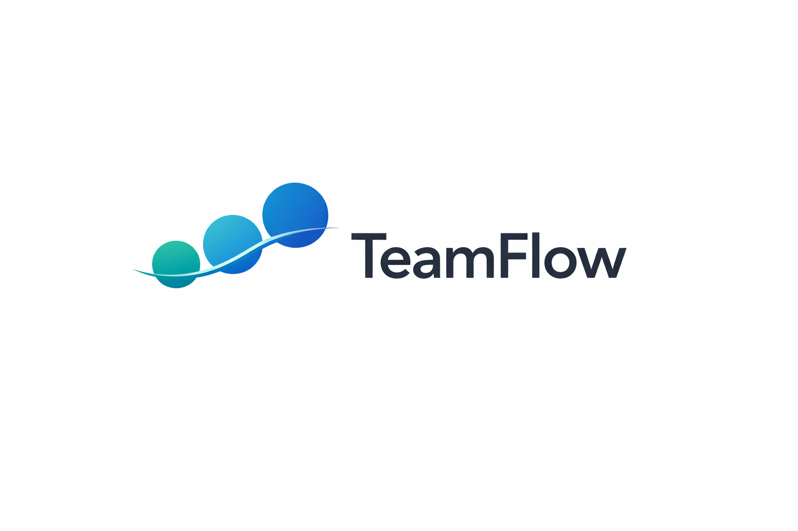

<div align="center">
  
  
  # 🏢 TeamFlow - Workforce Operating System

  ### Modern Multi-Tenant Employee & Task Management Platform with FlowAI Copilot
  
  [](https://nodejs.org/)
  [](https://react.dev/)
  [](https://vite.dev/)
  [](https://tailwindcss.com/)
  [](https://www.mongodb.com/)
  [](https://ai.google.dev/)
  [](./LICENSE)
  
  ---
  
  **Multi-Tenant Architecture** • **FlowAI Copilot** • **Interactive Sprint Simulator** • **Enterprise Grade Security**
  
  [Live Demo](https://your-deployed-url.vercel.app) • [Documentation](#-documentation) • [API Reference](#-api-documentation) • [Quick Start](#-getting-started) • [Report Bug](https://github.com/satyapradip/Employee-Management-System/issues)
  
</div>

---

## 📋 Table of Contents

- [🌟 About The Project](#-about-the-project)
- [✨ Core Features](#-core-features)
  - [🤖 FlowAI Workspace Copilot](#-flowai-workspace-copilot-new)
  - [🚀 Modern Landing Page & Interactive Sprint Simulator](#-modern-landing-page--interactive-sprint-simulator)
  - [👑 Admin Command Center](#-admin-command-center)
  - [👤 Employee Workspace & "Next Best Action"](#-employee-workspace--next-best-action)
  - [🏢 Multi-Tenant SaaS Onboarding](#-multi-tenant-saas-onboarding)
- [🎬 Live Demo Credentials & Seed Data](#-live-demo-credentials--seed-data)
- [🛠️ Tech Stack](#️-tech-stack)
- [🏛️ System Architecture](#️-system-architecture)
- [📁 Project Structure](#-project-structure)
- [🚀 Getting Started](#-getting-started)
  - [Prerequisites](#prerequisites)
  - [Installation](#installation)
  - [Environment Variables](#environment-variables)
  - [Database Seeding](#database-seeding)
  - [Running the Application](#running-the-application)
- [📖 Application Walkthrough & User Flows](#-application-walkthrough--user-flows)
- [📚 API Documentation](#-api-documentation)
- [🔒 Security & Multi-Tenant Isolation](#-security--multi-tenant-isolation)
- [🧪 Testing & Quality Assurance](#-testing--quality-assurance)
- [⚡ Performance Benchmarks](#-performance-benchmarks)
- [🔧 Troubleshooting & FAQ](#-troubleshooting--faq)
- [🗺️ Project Roadmap](#️-project-roadmap)
- [🤝 Contributing](#-contributing)
- [📄 License & Authors](#-license--authors)

---

## 🌟 About The Project

**TeamFlow** is an enterprise-ready, full-stack multi-tenant workforce management platform designed for modern engineering and operations teams. Built from the ground up with strict tenant isolation, TeamFlow powers deliverable delegation, sprint velocity tracking, and employee execution.

The platform combines a **modern light SaaS design foundation** (Geist typography, structured navy navigation, crisp borders, and subtle coral/indigo accents) with an embedded **FlowAI Workspace Copilot** powered by Google Gemini to streamline task drafting, architectural planning, and blocker resolution.

### Why TeamFlow?

- 🏢 **100% Multi-Tenant Data Isolation** — Automatic tenant filtering across every database query via strict `companyName` tenant contexts.
- 🤖 **Embedded FlowAI Copilot** — Context-aware Gemini 3.6 Flash copilot that writes structured deliverable specifications, drafts acceptance criteria, and suggests sprint optimizations.
- ⚡ **Interactive Sprint Simulator** — Landing page hero includes an interactive simulator allowing prospective teams to interact with real tasks, toggle completion states, and see burn-down metrics live.
- 🎯 **Employee "Next Best Action" Engine** — Focuses team members on their single highest-impact priority task with 1-click acceptance and blocker resolution logging.
- 📊 **Executive Analytics Suite** — Recharts-powered sprint velocity, status distribution breakdowns, and individual member throughput graphs.
- 🛡️ **Enterprise Security Foundation** — Environment-aware Helmet headers, dual-layer rate limiting (auth + global), XSS cleaning, MongoDB query sanitization, and HTTP-only JWT session handling.

---

## ✨ Core Features

### 🤖 FlowAI Workspace Copilot `NEW`

Built directly into the workspace layout via a global floating copilot modal (`AIAssistant.jsx`), **FlowAI** acts as an in-app Senior Engineering Lead and Solutions Architect powered by Google Gemini:

- **Role & Route Awareness:** Detects whether the user is an `admin` or `employee`, the active company workspace, and the current URL pathname to customize its suggestions.
- **Automated Deliverable Specifications:** Translates natural language requirements into structured JSON deliverable drafts (`task_draft`) containing:
  - Deliverable title & category (Frontend, Backend, Database, Security, DevOps, Design, QA)
  - Priority assessment (High, Medium, Low)
  - Due date estimation
  - Scope & architectural objective
  - Rigorous acceptance criteria
- **1-Click Integration:** Automatically populates Admin task creation forms or copies clean Markdown specifications to clipboard.
- **Contextual Prompts:** Built-in one-tap triggers for Sprint Planning, Blocker Triage, Architecture Reviews, and Code Quality metrics.
- **Docking Flexibility:** Minimize, expand full-screen, or quick-clear conversation state with graceful offline fallbacks.

### 🚀 Modern Landing Page & Interactive Sprint Simulator

- **Geist Typography & Light SaaS Aesthetics:** Crisp light surfaces (`#F5F6F7`), deep charcoal text (`#0F172A`), and geometric orbital arcs.
- **Interactive Sprint Simulator:** Fully interactive hero demonstration (`#simulator`) where visitors can click tasks, see status transitions (`active` -> `completed`), inspect burn-down progress, and experience the UI firsthand without registering.
- **4-Step Interactive Stepper:** Guided visual timeline showcasing Workspace Registration, Member Provisioning, Deliverable Delegation, and Velocity Measurement.
- **Target Persona Tabs:** Tailored feature matrices for Engineering Teams, Operations & HR, and Fast-Growing Startups.
- **FAQ Accordion & News Pill:** Direct answers to multi-tenancy, security, and migration questions with live release notification pill (`v2.4 Task AI Deployed`).

### 👑 Admin Command Center

- **Structured Navy Sidebar Navigation:** High-contrast navy (`#101827`) sidebar with active tab indicators, workspace identity badge, and full mobile drawer support.
- **Live Sprint KPI Counters:** Real-time summary tiles showing Total Tasks, Active Sprints, Completed Deliverables, and Blocked/Failed tasks.
- **4 Dedicated Management Panels:**
  1. **Tasks Tab:** Instant debounced search, status filter pills (`All`, `New`, `Active`, `Completed`, `Failed`), priority chips, assignee badges, due dates, and inline delete/edit modals.
  2. **Create Deliverable Tab:** Rich task composer supporting title, description, category selector, priority weighting, employee assignment dropdown, due date picker, and FlowAI autofill.
  3. **Employees Tab:** Team directory with individual member workload statistics, Add Employee modal, password reset utility, and member removal safeguards.
  4. **Analytics Tab:** Dynamic Recharts visualizations including Sprint Status Distribution, Category Breakdown, and Team Member Deliverable Velocity.
- **Quick Action Drawer:** Fast-access triggers for rapid task generation, member invitation, and export options.

### 👤 Employee Workspace & "Next Best Action"

- **Dynamic Welcome Banner:** Greets employees based on local time (*"Good morning"*, *"Good afternoon"*, *"Good evening"*) alongside the live formatted date.
- **Personal Deliverable KPIs:** Real-time counters showing personal counts for New Tasks, In Progress, Delivered, and Blocked items.
- **"Next Best Action" Card:** Intelligent decision helper that evaluates queue state:
  - If new unaccepted tasks exist: Highlights the top deliverable with a prominent **1-Click "Accept First Task"** button.
  - If tasks are in flight: Focuses the employee on execution with active timer counters.
  - If queue is clear: Displays an achievement banner celebrating full sprint completion.
- **Deliverable Queue (`TaskList`):**
  - Instant 1-Click Accept (`new` -> `active`).
  - Mark Complete with timestamp recording (`active` -> `completed`).
  - Mark Failed / Document Blocker modal (`active` -> `failed`) requiring reason submission to alert the engineering lead.

### 🏢 Multi-Tenant SaaS Onboarding

- **3-Step Company Registration (`/register-company`):**
  1. *Organization Profile:* Company name, reserved workspace subdomain (`[subdomain].teamflow.space`), industry vertical, and team size.
  2. *Primary Administrator:* Full name, executive email, and password.
  3. *Tiered Plan Confirmation:* Interactive selection between Starter, Growth, and Enterprise tiers.
- **SaaS Card Suite Auth:** Modern card layouts for Login, Sign Up, Forgot Password, and Reset Password with secure token validation.

---

## 🎬 Live Demo Credentials & Seed Data

The database includes an automated seeder (`server/src/seeders/seedData.js`) configured with **Acme Corp** workspace data:

| Role | Name | Email | Password | Company Workspace | Notes |
| :--- | :--- | :--- | :--- | :--- | :--- |
| 👑 **Admin** | Admin User | `admin@company.com` | `admin123` | Acme Corp | Full Command Center access |
| 👤 **Employee** | John Doe | `john@company.com` | `123456` | Acme Corp | Frontend & API tasks |
| 👤 **Employee** | Jane Smith | `jane@company.com` | `123456` | Acme Corp | Database & Schema tasks |
| 👤 **Employee** | Mike Johnson | `mike@company.com` | `123456` | Acme Corp | Security & DevOps tasks |
| 👤 **Employee** | Sarah Wilson | `sarah@company.com` | `123456` | Acme Corp | QA & Testing deliverables |
| 👤 **Employee** | Tom Brown | `tom@company.com` | `123456` | Acme Corp | Infrastructure tasks |
| 👤 **Employee** | Pradipta Kumar | `supritimaity59@gmail.com` | `123456` | Acme Corp | Lead developer workspace |

> **💡 Quick Tip:** Running `npm run seed` inside the `server/` folder populates this complete organization structure with 20 realistic deliverables spread across `new`, `active`, `completed`, and `failed` states.

---

## 🛠️ Tech Stack

### **Frontend Architecture**

| Technology | Version | Purpose |
| :--- | :--- | :--- |
| **[React](https://react.dev/)** | `19.1.1` | Concurrent UI framework with hooks and functional components |
| **[Vite](https://vite.dev/)** | `7.1.2` | Build tool, HMR server, and local reverse proxy (`/api`) |
| **[Tailwind CSS](https://tailwindcss.com/)** | `4.1.18` | Next-gen utility-first styling powered by `@tailwindcss/vite` |
| **[React Router](https://reactrouter.com/)** | `7.13.0` | Client-side declarative routing and role guards |
| **[Framer Motion](https://www.framer.com/motion/)** | `12.33.0` | Physics-based animations and layout transitions |
| **[Recharts](https://recharts.org/)** | `3.7.0` | Declarative SVG charting for the Admin Analytics suite |
| **[Lucide React](https://lucide.dev/)** | `0.563.0` | Modern SVG iconography |
| **[Three.js](https://threejs.org/)** / **[R3F](https://docs.pmnd.rs/react-three-fiber/)** | `0.182.0` / `9.5.0` | 3D graphics and canvas rendering |
| **[Google Gemini API](https://ai.google.dev/)** | `3.6 Flash` | FlowAI Workspace Copilot integration |

### **Backend Architecture**

| Technology | Version | Purpose |
| :--- | :--- | :--- |
| **[Node.js](https://nodejs.org/)** | `18+` (ESM) | Modern JavaScript runtime |
| **[Express.js](https://expressjs.com/)** | `4.21.0` | REST API framework |
| **[MongoDB](https://www.mongodb.com/)** | `8.0` / Atlas | NoSQL database with multi-tenant collections |
| **[Mongoose](https://mongoosejs.com/)** | `8.5.1` | Object data modeling and tenant schema enforcement |
| **[jsonwebtoken](https://jwt.io/)** | `9.0.2` | Stateless cryptographic session tokens (7-day validity) |
| **[bcryptjs](https://github.com/dcodeIO/bcrypt.js)** | `2.4.3` | One-way password hashing (10 salt rounds) |
| **[express-rate-limit](https://github.com/express-rate-limit/express-rate-limit)** | `8.2.1` | Multi-tier rate limiting for auth and global endpoints |
| **[express-validator](https://express-validator.github.io/)** | `7.1.0` | Declarative schema validation and payload sanitization |
| **[Helmet](https://helmetjs.github.io/)** | `8.1.0` | Environment-aware security header suite (HSTS, CSP) |
| **[Nodemailer](https://nodemailer.com/)** | `7.0.12` | SMTP delivery for password reset tokens and invites |
| **[Jest](https://jestjs.io/)** & **[Supertest](https://github.com/ladjs/supertest)** | `30.2.0` / `7.2.2` | Automated integration and route testing |

---

## 🏛️ System Architecture

```
┌────────────────────────────────────────────────────────────────────────┐
│                              CLIENT LAYER                              │
│                                                                        │
│   Landing Page       Admin Command Center        Employee Workspace    │
│  (Sprint Simulator)   (Navy Sidebar, Analytics)   (Next Best Action)   │
│         │                     │                         │              │
│         └─────────────────────┴─────────────────────────┘              │
│                               │                                        │
│                 React Router 7 & Protected Guards                      │
│                               │                                        │
│                 Vite Reverse Proxy (/api)                              │
│              (Eliminates CORS & PNA on Localhost)                      │
└───────────────────────────────┬────────────────────────────────────────┘
                                │
                                ▼
┌────────────────────────────────────────────────────────────────────────┐
│                           API GATEWAY LAYER                            │
│  ┌──────────────────────────────────────────────────────────────────┐  │
│  │                        Express 4 REST API                        │  │
│  │                                                                  │  │
│  │   /api/auth/*          /api/tasks/*          /api/employees/*    │  │
│  │   • Login / Register   • CRUD Operations     • Directory Stats   │  │
│  │   • Password Reset     • Accept / Complete   • Password Reset    │  │
│  │   • Session / Me       • Fail with Reason    • Member Management │  │
│  │                                                                  │  │
│  │  ┌────────────────────────────────────────────────────────────┐  │  │
│  │  │                     Middleware Pipeline                    │  │  │
│  │  │  1. CORS Origin Whitelist                                  │  │  │
│  │  │  2. Environment-Aware Helmet Security Headers              │  │  │
│  │  │  3. Compression & HTTP Parameter Pollution (HPP)          │  │  │
│  │  │  4. Data Sanitization (mongoSanitize + xss-clean)          │  │  │
│  │  │  5. Tiered Rate Limiting (Global 100/15m, Auth 20/15m)     │  │  │
│  │  │  6. JWT Token Verification & RBAC Authorization            │  │  │
│  │  └────────────────────────────────────────────────────────────┘  │  │
│  └────────────────────────────┬─────────────────────────────────────┘  │
└───────────────────────────────┼────────────────────────────────────────┘
                                │
                                ▼
┌────────────────────────────────────────────────────────────────────────┐
│                              DATA LAYER                                │
│  ┌──────────────────────────────────────────────────────────────────┐  │
│  │                       MongoDB Database                           │  │
│  │                                                                  │  │
│  │   Users Collection               Tasks Collection                │  │
│  │   • id, name, email              • id, title, description        │  │
│  │   • password (bcrypt)            • category, priority, dueDate   │  │
│  │   • role (admin | employee)      • status (new/active/done/fail) │  │
│  │   • companyName (TENANT)         • assignedTo, assignedBy        │  │
│  │                                  • companyName (TENANT)          │  │
│  │                                                                  │  │
│  │       🔒 Mandatory Multi-Tenant Filter: { companyName }          │  │
│  └──────────────────────────────────────────────────────────────────┘  │
└────────────────────────────────────────────────────────────────────────┘
```

---

## 📁 Project Structure

```
Employee_Management_System/
│
├── 📂 src/                          # Frontend Application (React 19 + Vite 7)
│   ├── 📂 components/
│   │   ├── 📂 AI/                   # FlowAI Workspace Copilot
│   │   │   └── AIAssistant.jsx      # Gemini 3.6 Flash copilot interface
│   │   │
│   │   ├── 📂 Admin/                # Admin Command Center
│   │   │   ├── AdminDashboard.jsx   # Master container with navy sidebar
│   │   │   ├── 📂 components/       # Modular Admin UI components
│   │   │   │   ├── AnalyticsTab.jsx # Recharts charts & velocity graphs
│   │   │   │   ├── CategorySelector.jsx # Deliverable category picker
│   │   │   │   ├── CreateTaskTab.jsx    # Task composer with FlowAI injection
│   │   │   │   ├── DeleteConfirmModal.jsx # Confirmation dialog
│   │   │   │   ├── EmployeesTab.jsx # Team directory & credential reset
│   │   │   │   ├── FilterPills.jsx  # Status filter toggles
│   │   │   │   ├── QuickActions.jsx # Fast shortcut buttons
│   │   │   │   ├── SearchBar.jsx    # Debounced task search
│   │   │   │   ├── Sidebar.jsx      # Dark navy sidebar navigation
│   │   │   │   ├── StatsCard.jsx    # Real-time sprint KPI cards
│   │   │   │   ├── TaskCard.jsx     # Individual task card
│   │   │   │   ├── TasksTab.jsx     # Filtered deliverable board
│   │   │   │   └── index.js
│   │   │   └── 📂 hooks/            # Custom hooks for state & API
│   │   │       ├── useTaskManager.js
│   │   │       ├── useEmployees.js
│   │   │       └── useAnalytics.js
│   │   │
│   │   ├── 📂 Auth/                 # Authentication Card Suite
│   │   │   ├── Login.jsx            # Sign in with quick role presets
│   │   │   ├── Signup.jsx           # Account creation
│   │   │   ├── ForgotPassword.jsx   # Reset token dispatch
│   │   │   └── ResetPassword.jsx    # Password change form
│   │   │
│   │   ├── 📂 Dashboard/            # Employee Workspace
│   │   │   └── EmployeeDashboard.jsx # Welcome banner, KPI cards & Next Best Action
│   │   │
│   │   ├── 📂 TaskList/             # Deliverable Resolution Board
│   │   │   └── TaskList.jsx         # 1-click Accept, Complete, Fail modals
│   │   │
│   │   ├── 📂 ErrorBoundary/        # Fault isolation & crash guards
│   │   │   └── RouteErrorBoundary.jsx
│   │   │
│   │   └── 📂 others/               # Shared interface components
│   │       ├── Header.jsx           # Topbar with profile & logout
│   │       └── TaskListNumber.jsx   # Numerical KPI counters
│   │
│   ├── 📂 pages/                    # Public Marketing & Onboarding Pages
│   │   ├── LandingPage.jsx          # Hero arc, Sprint Simulator & feature matrix
│   │   └── CompanyRegistration.jsx  # 3-step organization onboarding
│   │
│   ├── 📂 context/                  # React Contexts
│   │   ├── AuthProvider.jsx         # Token persistence & user state
│   │   └── ToastProvider.jsx        # Notification dispatch
│   │
│   ├── 📂 services/                 # Centralized HTTP layer
│   │   └── api.js                   # Fetch client configured for Vite proxy
│   │
│   ├── 📂 utils/                    # Shared utilities
│   │   ├── logger.js                # Environment-aware logging
│   │   └── validation.js            # Input check helpers
│   │
│   ├── App.jsx                      # App router & FlowAI copilot root
│   ├── main.jsx                     # Application bootstrap
│   └── index.css                    # Tailwind CSS v4 imports & design tokens
│
├── 📂 server/                       # Backend Application (Node.js + Express)
│   ├── 📂 src/
│   │   ├── 📂 config/               # Database & environment configurations
│   │   │   ├── db.js                # MongoDB connection handler
│   │   │   ├── env.js               # Validated env configurations
│   │   │   └── index.js
│   │   │
│   │   ├── 📂 controllers/          # Business logic handlers
│   │   │   ├── authController.js    # Registration, login, password reset
│   │   │   ├── taskController.js    # Task CRUD, status updates, stats
│   │   │   └── employeeController.js# Team management, metrics
│   │   │
│   │   ├── 📂 middleware/           # Express middleware pipeline
│   │   │   ├── auth.js              # JWT verification & tenant extraction
│   │   │   ├── validate.js          # Express-validator error handler
│   │   │   └── errorHandler.js      # Global error and 404 handlers
│   │   │
│   │   ├── 📂 models/               # Mongoose Schemas with multi-tenancy
│   │   │   ├── User.js              # User schema with bcrypt hooks
│   │   │   └── Task.js              # Deliverable schema with status transitions
│   │   │
│   │   ├── 📂 routes/               # API endpoint definitions
│   │   │   ├── authRoutes.js        # /api/auth/*
│   │   │   ├── taskRoutes.js        # /api/tasks/*
│   │   │   ├── employeeRoutes.js    # /api/employees/*
│   │   │   └── index.js             # Route aggregator & /api/health
│   │   │
│   │   ├── 📂 seeders/              # Database population scripts
│   │   │   └── seedData.js          # Acme Corp seed generator
│   │   │
│   │   └── app.js                   # Express application setup
│   │
│   ├── server.js                    # Server entrypoint
│   ├── package.json                 # Backend dependencies & test scripts
│   └── jest.config.js               # Unit and integration test config
│
├── 📂 public/                       # Static public assets
│   ├── TeamFlow_logo.png            # Official brand logo
│   └── vite.svg
│
├── .env.example                     # Root environment variable template
├── package.json                     # Frontend dependencies & build scripts
├── vite.config.js                   # Vite configuration with API reverse proxy
├── eslint.config.js                 # Modern ESLint configuration
└── README.md                        # Project documentation (this file)
```

---

## 🚀 Getting Started

### Prerequisites

Ensure the following tools are installed on your machine:
- **Node.js:** v18.0.0 or later (`node -v`)
- **npm:** v9.0.0 or later (`npm -v`)
- **MongoDB:** v6.0+ local instance or a free [MongoDB Atlas](https://www.mongodb.com/atlas) cloud cluster

### Installation

**1. Clone the Repository:**

```bash
git clone https://github.com/satyapradip/Employee-Management-System.git
cd Employee-Management-System
```

**2. Install Root (Frontend) Dependencies:**

```bash
npm install
```

**3. Install Server (Backend) Dependencies:**

```bash
cd server
npm install
cd ..
```

---

### Environment Variables

Configure your local environment files for both frontend and backend.

#### 1. Frontend Configuration (`.env`)

Create `.env` in the **root project directory**:

```env
# Use relative /api in development to leverage the Vite proxy (avoids CORS & PNA issues)
VITE_API_URL=/api

# Google Gemini API Key for the FlowAI Workspace Copilot
VITE_GEMINI_API_KEY=your_gemini_api_key_here
```

> **🔑 Gemini API Key:** You can generate a free Gemini API key from [Google AI Studio](https://aistudio.google.com/).

#### 2. Backend Configuration (`server/.env`)

Create `.env` in the `server/` directory:

```env
# Server Configuration
PORT=5000
NODE_ENV=development

# MongoDB Connection (Local or Atlas)
MONGODB_URI=mongodb://localhost:27017/employee_management
# For MongoDB Atlas:
# MONGODB_URI=mongodb+srv://<username>:<password>@cluster0.xxxxx.mongodb.net/employee_management?retryWrites=true&w=majority

# JWT Token Configuration
JWT_SECRET=super_secret_jwt_passphrase_minimum_32_characters_long
JWT_EXPIRE=7d

# Frontend Origin for CORS (comma-separated list supported)
CLIENT_URL=http://localhost:5173,http://localhost:5174,http://127.0.0.1:5173

# Optional: Email Service for Password Resets
GMAIL_USER=your-email@gmail.com
GMAIL_APP_PASSWORD=your-gmail-app-password
EMAIL_FROM="TeamFlow Support" <noreply@teamflow.com>

# FlowAI Engine Key (Optional on backend)
GEMINI_API_KEY=your_gemini_api_key_here
```

---

### Database Seeding

Populate your database with the complete Acme Corp demo workspace:

```bash
cd server
npm run seed
cd ..
```

This generates:
- 🏢 Company Workspace: **Acme Corp**
- 👑 1 Administrator account (`admin@company.com`)
- 👥 6 Employee accounts (`john@company.com`, `jane@company.com`, etc.)
- 📋 20 Realistic tasks across `new`, `active`, `completed`, and `failed` statuses with categories, priorities, due dates, and documented failure reasons.

---

### Running the Application

You can launch both services using separate terminals:

#### Terminal 1 — Backend API Server:

```bash
cd server
npm run dev
```
*API server will start on [http://localhost:5000](http://localhost:5000).*

#### Terminal 2 — Frontend Application:

```bash
npm run dev
```
*Vite dev server will start on [http://localhost:5173](http://localhost:5173).*

> **💡 Zero CORS Configuration:** Because Vite is configured with a built-in reverse proxy in `vite.config.js`:
> ```javascript
> proxy: {
>   "/api": {
>     target: "http://127.0.0.1:5000",
>     changeOrigin: true,
>     secure: false,
>   }
> }
> ```
> Frontend requests to `/api/*` are automatically proxied to the backend on port 5000 without cross-origin friction or Private Network Access (PNA) browser warnings.

---

## 📖 Application Walkthrough & User Flows

```
                        ┌────────────────────────────────┐
                        │      Landing Page (/)          │
                        │ • Interactive Sprint Simulator │
                        └───────────────┬────────────────┘
                                        │
                 ┌──────────────────────┴──────────────────────┐
                 ▼                                             ▼
  ┌──────────────────────────────┐              ┌──────────────────────────────┐
  │  Company Registration        │              │  Authentication Card Suite   │
  │  (/register-company)         │              │  (/login, /signup)           │
  │  1. Organization Profile     │              │  • Pre-filled quick sign-in  │
  │  2. Admin Account            │              │  • Email password recovery   │
  │  3. Plan Selection           │              └──────────────┬───────────────┘
  └──────────────┬───────────────┘                             │
                 │                                             │
                 └──────────────────────┬──────────────────────┘
                                        │ Authenticated Session
                                        ▼
                 ┌─────────────────────────────────────────────┐
                 │          Role-Based Access Routing          │
                 └──────────────┬───────────────┬──────────────┘
                                │               │
          role === "admin"      │               │  role === "employee"
                                ▼               ▼
   ┌────────────────────────────────┐       ┌────────────────────────────────┐
   │    Admin Command Center        │       │       Employee Workspace       │
   │    (/admin)                    │       │       (/employee)              │
   │ • Navy Sidebar Navigation      │       │ • Welcome Banner & Live Time   │
   │ • Real-time Sprint KPI Cards   │       │ • Personal Task Counters       │
   │ • Tasks Board with Filters     │       │ • "Next Best Action" Guidance  │
   │ • Deliverable Creator Tab      │       │ • Deliverable Queue Board      │
   │ • Employee Directory & Actions │       │ • 1-Click Accept Deliverable   │
   │ • Recharts Sprint Analytics    │       │ • Mark Complete                │
   │                                │       │ • Mark Failed (Log Blocker)    │
   └────────────────┬───────────────┘       └────────────────┬───────────────┘
                    │                                        │
                    └───────────────────┬────────────────────┘
                                        │
                                        ▼
                     ┌──────────────────────────────────────┐
                     │   Global FlowAI Workspace Copilot    │
                     │   (<AIAssistant />)                  │
                     │ • Gemini 3.6 Flash Contextual AI     │
                     │ • Generates Task Drafts (JSON)       │
                     │ • Direct Insert into Task Composer   │
                     │ • Architecture & Sprint Optimization │
                     └──────────────────────────────────────┘
```

---

## 📚 API Documentation

### Base URL

```http
Development: http://localhost:5173/api  (via Vite Proxy)
Direct Backend: http://localhost:5000/api
```

### Authorization Header

All protected routes require a Bearer token:

```http
Authorization: Bearer <your_jwt_token>
```

---

### Authentication Endpoints (`/api/auth`)

| Method | Endpoint | Access | Description |
| :--- | :--- | :--- | :--- |
| `POST` | `/api/auth/register-admin` | Public | Register new organization & administrator account |
| `POST` | `/api/auth/register` | Public | Create new user account |
| `POST` | `/api/auth/login` | Public | Authenticate user & return JWT token |
| `POST` | `/api/auth/logout` | Public | Clear user session |
| `POST` | `/api/auth/forgot-password` | Public | Request password reset token via email |
| `GET` | `/api/auth/reset-password/:token` | Public | Verify validity of a password reset token |
| `POST` | `/api/auth/reset-password/:token` | Public | Set new password with valid token |
| `GET` | `/api/auth/me` | Protected | Fetch currently logged-in user profile |
| `PUT` | `/api/auth/me` | Protected | Update profile details |
| `PUT` | `/api/auth/change-password` | Protected | Change password with current password verification |

---

### Task Management Endpoints (`/api/tasks`)

| Method | Endpoint | Access | Description |
| :--- | :--- | :--- | :--- |
| `GET` | `/api/tasks` | Protected | List tasks (filtered by user role and tenant) |
| `GET` | `/api/tasks/stats` | Admin | Get aggregated task statistics for company |
| `GET` | `/api/tasks/:id` | Protected | Retrieve single task by ID |
| `POST` | `/api/tasks` | Admin | Create a new task deliverable |
| `PUT` | `/api/tasks/:id` | Admin | Update existing task details |
| `DELETE` | `/api/tasks/:id` | Admin | Delete a task |
| `PUT` | `/api/tasks/:id/accept` | Employee | Accept new task (`new` -> `active`) |
| `PUT` | `/api/tasks/:id/complete` | Employee | Mark task completed (`active` -> `completed`) |
| `PUT` | `/api/tasks/:id/fail` | Employee | Mark task failed (`active` -> `failed`) with `failureReason` |

#### Filtering Parameters (`GET /api/tasks`):
- `status` — `new`, `active`, `completed`, `failed`, `all`
- `category` — Filter by category (`Frontend`, `Backend`, `Database`, `Security`, etc.)
- `priority` — Filter by priority (`low`, `medium`, `high`, `urgent`)
- `search` — Full-text search across titles and descriptions
- `assignedTo` — Filter by employee ID (Admin only)

---

### Employee Management Endpoints (`/api/employees`)

| Method | Endpoint | Access | Description |
| :--- | :--- | :--- | :--- |
| `GET` | `/api/employees` | Admin | Retrieve all employees belonging to company |
| `GET` | `/api/employees/dashboard` | Admin | Get comprehensive company dashboard statistics |
| `GET` | `/api/employees/:id` | Admin | Retrieve specific employee by ID |
| `POST` | `/api/employees` | Admin | Create and provision a new employee |
| `PUT` | `/api/employees/:id` | Admin | Update employee profile |
| `DELETE` | `/api/employees/:id` | Admin | Remove an employee |
| `PUT` | `/api/employees/:id/reset-password`| Admin | Reset employee's password |

---

### System Health

| Method | Endpoint | Access | Description |
| :--- | :--- | :--- | :--- |
| `GET` | `/api/health` | Public | Returns service status and ISO timestamp |

---

## 🔒 Security & Multi-Tenant Isolation

TeamFlow enforces multi-layered defense to guarantee tenant privacy and system availability:

1. **Tenant Isolation by Construction:**
   - Every user belongs to a specific `companyName`.
   - All Mongoose queries for tasks, metrics, and employees automatically inject `{ companyName: req.user.companyName }`.
   - Cross-company data leakage is structurally impossible at the controller and database layer.

2. **Environment-Aware HTTP Security:**
   - In production, Helmet enforces strict Content Security Policy (CSP), Cross-Origin Resource Policy (CORP), and HTTP Strict Transport Security (HSTS) with a 1-year max age.
   - In local development, HSTS and restrictive localhost blocking policies are intelligently disabled to prevent browser fetch locks.

3. **Multi-Tier Rate Limiting:**
   - **Authentication Limiter:** 20 requests per 15 minutes in production (generous in development) with `skipSuccessfulRequests: true`.
   - **Password Recovery Limiter:** 3 requests per hour in production.
   - **Global Limiter:** 100 requests per 15 minutes per IP address.

4. **Input Sanitization & Parameter Protection:**
   - `express-mongo-sanitize` strips `$` and `.` operators to prevent NoSQL injection attacks.
   - `xss-clean` neutralizes malicious HTML/script payloads in request bodies.
   - `hpp` prevents HTTP Parameter Pollution attacks.
   - Passwords hashed using `bcryptjs` with 10 salt rounds before storage.

---

## 🧪 Testing & Quality Assurance

The backend includes test suites built with **Jest** and **Supertest**:

```bash
# Run backend test suite
cd server
npm test

# Run tests in watch mode
npm run test:watch

# Generate code coverage report
npm run test:coverage
```

### Frontend Code Quality

```bash
# Run ESLint across frontend components
npm run lint

# Run production build validation
npm run deploy:check
```

---

## ⚡ Performance Benchmarks

- **Frontend Bundle Size:** Optimized with Vite 7 tree-shaking, code splitting, and `@tailwindcss/vite` atomic CSS generation.
- **Dynamic Chart Rendering:** Recharts components are rendered client-side with container boundaries to prevent layout reflows.
- **Backend Response Latency:** Sub-50ms average response time for tenant-scoped indexed MongoDB queries.
- **Compression:** Gzip/Brotli payload compression enabled on the Express server via `compression()`.

---

## 🔧 Troubleshooting & FAQ

<details>
<summary><b>1. How do I fix "Missing Gemini API Key" in FlowAI Copilot?</b></summary>

Ensure your root `.env` file contains a valid `VITE_GEMINI_API_KEY`:
```env
VITE_GEMINI_API_KEY=your_key_here
```
After updating the file, restart the Vite dev server (`npm run dev`). You can obtain a free API key from [Google AI Studio](https://aistudio.google.com/).
</details>

<details>
<summary><b>2. Why does Tailwind CSS v4 not have a tailwind.config.js?</b></summary>

Tailwind CSS v4 replaces the legacy JavaScript configuration file with a CSS-first architecture. All theme variables, utility layers, and directives are defined in [src/index.css](file:///e:/Employee_Management_System/src/index.css) using `@import "tailwindcss";` and custom `@layer base` CSS custom properties.
</details>

<details>
<summary><b>3. I'm getting "MongooseServerSelectionError" when starting the server</b></summary>

1. Verify that your MongoDB service is running locally (`net start MongoDB` on Windows or `sudo systemctl start mongod` on Linux).
2. If using MongoDB Atlas, make sure your current IP address is whitelisted under **Network Access** in the Atlas console.
3. Check that your connection string in `server/.env` is formatted correctly.
</details>

<details>
<summary><b>4. How do I clear and re-seed the demo database?</b></summary>

Simply navigate into the `server/` directory and run:
```bash
npm run seed
```
This drops the existing users and tasks collections and re-seeds Acme Corp with the default admin and 6 employees.
</details>

<details>
<summary><b>5. Port 5173 or 5000 is already in use</b></summary>

On Windows:
```powershell
netstat -ano | findstr :5000
taskkill /PID <PID> /F
```
On Linux/macOS:
```bash
lsof -ti:5000 | xargs kill -9
```
Alternatively, configure a different port in `server/.env` or let Vite select the next available port (5174).
</details>

---

## 🗺️ Project Roadmap

### ✅ Completed & Implemented

- [x] Multi-tenant architecture with company-isolated queries
- [x] Modern SaaS Light Design System with Geist typography
- [x] Landing page with Orbital Geometric Arc & Interactive Sprint Simulator
- [x] Embedded **FlowAI Workspace Copilot** powered by Google Gemini 3.6 Flash
- [x] Admin Command Center with structured Navy Sidebar
- [x] Interactive Recharts Analytics Suite (velocity, status distribution, member throughput)
- [x] Employee Workspace with dynamic Welcome Banner & KPI counters
- [x] Employee **"Next Best Action"** guidance engine with 1-click task acceptance
- [x] Blocker documentation flow (`failTask` with mandatory explanation modal)
- [x] 3-Step Company Registration with subdomain reservation
- [x] Vite reverse proxy (`/api`) eliminating CORS & Private Network Access issues
- [x] Database seeder with complete Acme Corp organization suite

### 🔄 In Progress & Next Phase

- [ ] Real-time web socket updates for live deliverable status changes (Socket.io)
- [ ] Drag-and-drop Kanban view toggle alongside list view
- [ ] File and document attachments on deliverables
- [ ] Direct comments and thread discussion on individual task cards
- [ ] Exportable sprint reports (PDF and CSV)

---

## 🤝 Contributing

Contributions are welcomed! Follow these steps to contribute:

1. **Fork the Repository:** Create your own branch from `main`.
2. **Create a Feature Branch:** `git checkout -b feature/your-feature-name`
3. **Commit Your Changes:** Follow conventional commit messages:
   ```bash
   git commit -m "feat(tasks): add priority filter preset"
   ```
4. **Push to Your Fork:** `git push origin feature/your-feature-name`
5. **Open a Pull Request:** Provide a clear description of the problem solved.

---

## 📄 License & Authors

This project is licensed under the **MIT License** — see the [LICENSE](./LICENSE) file for complete details.

**Project Lead & Maintainer:**
- **Satya Pradip** — [@satyapradip](https://github.com/satyapradip)

---

<div align="center">
  <b>Built with ❤️ using React 19, Node.js, Tailwind CSS v4 & Google Gemini AI</b>
  <br>
  <i>Empowering modern teams to move faster with clarity and intelligence.</i>
</div>
